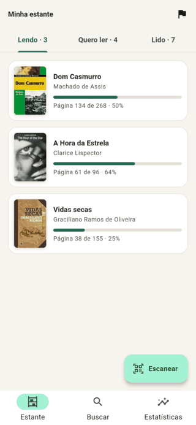

# Estante · organize suas leituras em Flutter

[](https://github.com/jonascarvalh/bookshelf-app/actions/workflows/ci.yml)

O Estante é um app para **buscar livros, escanear o código de barras** de um livro físico e **acompanhar a própria leitura**. Os dados vêm da [API da Open Library](https://openlibrary.org/developers/api), que é gratuita e não exige chave nem cadastro.

Ele foi feito como projeto de portfólio, seguindo o [Fluxo](https://github.com/jonascarvalh/finance-app). Os focos aqui são **integração com REST**, um **repositório offline-first** e **hardware** (câmera e notificações).

<p align="center">
  
</p>

> **APK:** baixe a versão mais recente em [Releases](https://github.com/jonascarvalh/bookshelf-app/releases). O CI gera o arquivo a cada tag `v*`.
> **Landing page:** [jonascarvalh.github.io/bookshelf-app](https://jonascarvalh.github.io/bookshelf-app/)

---

## Sumário

- [Funcionalidades](#funcionalidades)
- [Estratégia de cache (offline-first)](#estratégia-de-cache-offline-first)
- [Rede: timeout, repetição e erros](#rede-timeout-repetição-e-erros)
- [Arquitetura](#arquitetura)
- [Navegação e deep link](#navegação-e-deep-link)
- [Permissões e hardware](#permissões-e-hardware)
- [Tecnologias](#tecnologias)
- [Rodando o projeto](#rodando-o-projeto)
- [Testes](#testes)
- [CI e Releases](#ci-e-releases)

---

## Funcionalidades

**Busca**
- Por título ou autor, com *debounce* enquanto você digita.
- **Rolagem infinita**: a próxima página é pedida antes de chegar ao fim da lista.
- Capas baixadas da internet e guardadas no aparelho. Sem capa, o app gera uma com o título e o autor.
- Estados de carregamento (esqueleto), lista vazia, erro com "Tentar novamente" e erro só na página seguinte, sem perder a lista.

**Leitor de código de barras**
- Aponte a câmera para o ISBN da contracapa e o livro abre. Só códigos EAN-13 978/979 com dígito verificador válido são aceitos.
- Também dá para **digitar o ISBN**, o que é útil quando a câmera não está disponível ou a permissão foi negada.

**Estante**
- Prateleiras **Quero ler**, **Lendo** e **Lido**.
- Progresso por páginas. Chegar à última página marca o livro como lido. Se a API não informa o total, o usuário informa.

**Offline**
- Livros já vistos, buscas recentes, sinopses, capas e toda a estante ficam salvos no aparelho.
- Uma faixa avisa quando você está sem internet. Resultados vindos do cache mostram a data em que foram salvos.

**Meta e lembrete**
- Meta anual de livros, com o ritmo necessário ("cerca de 1,3 livro por mês").
- **Lembrete diário** por notificação local, no horário escolhido. Ele é reagendado depois que o aparelho reinicia.

**Estatísticas**
- Progresso da meta do ano, dias seguidos de leitura, páginas no mês e leituras em andamento.
- Gráficos de **livros terminados** e **páginas lidas** nos últimos 6 meses.

---

## Estratégia de cache (offline-first)

A tela nunca lê a API diretamente. Ela lê o **banco local** (drift/SQLite), e a API só serve para **atualizar esse banco**. O repositório devolve um `Stream<Snapshot<T>>`, que pode emitir mais de um valor para a mesma consulta:

```
           ┌──────────── cache local existe? ────────────┐
           │ sim                                          │ não
   recente (< 30 min)?                                    │
     │ sim          │ não                                 │
  emite cache    emite cache (isRefreshing: true)         │
  e termina            │                                  │
                       ▼                                  ▼
                 ── está online? ──────────────────────────
                   │ sim                         │ não
              chama a API                  emite cache + NoConnectionFailure
            ┌──────┴───────┐               (ou só a falha, se não há cache)
          sucesso        falha
     salva no banco   emite cache + falha (Timeout, Server…)
     emite "remote"   → a lista continua na tela, com aviso
```

| Dado | Onde fica | Validade | Por quê |
|---|---|---|---|
| Página de busca (`query` + `page`) | tabela `search_cache_entries`, com a ordem dos ids e o total | **30 min** sem ir à rede; depois mostra o cache e revalida | Quem volta para a mesma busca, ou rola para cima e para baixo, não faz requisição repetida. O catálogo da Open Library muda devagar. |
| Livro (título, autores, páginas, ISBNs) | tabela `books`, uma linha por obra | atualizado a cada busca que o traz | Evita guardar o mesmo livro várias vezes. A busca só guarda os ids. |
| Sinopse (`/works/{id}.json`) | coluna `description` em `books` | **7 dias** | Muda raramente e custa uma requisição extra por livro. Uma nova busca **não apaga** a sinopse salva. |
| Capas | arquivos em `ApplicationSupport/covers` e um LRU em memória (80) | permanente | Imagens são o que mais pesa na rede, e a estante precisa ficar bonita offline. |
| Estante, progresso e histórico | tabelas `shelf_entries` e `reading_logs` | **só local** | É dado do usuário. Não depende de internet nem de conta. |

**Limpeza:** ao abrir o app, buscas com mais de **30 dias** são apagadas, junto com os livros que só elas usavam. Livros que estão na estante nunca saem do cache.

**Decisões e trade-offs**
- **Stale-while-revalidate em vez de cache-first puro.** O usuário vê algo na hora e recebe a versão nova logo em seguida. Com a janela de 30 minutos, a rede não é usada à toa.
- **Conectividade é uma dica, não uma garantia.** Com `connectivity_plus` offline, o app nem tenta a rede, o que economiza bateria e o tempo dos timeouts. Online, as falhas reais de rede continuam tratadas.
- **A busca e o cache usam a mesma chave normalizada.** `"  MACHADO  de Assis"` e `"machado de assis"` são a mesma busca.
- **Falhas do cache não bloqueiam a rede.** Se a leitura do banco falhar, o app vai à API. Se a gravação falhar, o dado que já chegou continua na tela.
- **Página vazia encerra a rolagem**, mesmo que `numFound` diga que há mais. O índice da Open Library às vezes superestima o total.

O código está em [`book_repository_impl.dart`](lib/features/books/data/repositories/book_repository_impl.dart) e os testes em [`book_repository_impl_test.dart`](test/features/books/data/book_repository_impl_test.dart). Os testes usam o banco real em memória e a API simulada no nível HTTP.

---

## Rede: timeout, repetição e erros

- **Dio** com `connectTimeout` de 8 s, `receiveTimeout` de 12 s e um `User-Agent` identificável, como a Open Library pede.
- **[`RetryInterceptor`](lib/core/network/retry_interceptor.dart)**: repete até 2 vezes, com *backoff* exponencial (600 ms, 1,2 s), quando há timeout, falha de conexão, 408, 429 ou 5xx. Um 404 não é repetido, porque a resposta seria a mesma.
- O *data source* converte `DioException` em `ApiException`, e o repositório converte `ApiException` em uma `Failure` *sealed*: `NoConnectionFailure`, `TimeoutFailure`, `ServerFailure`, `NotFoundFailure`, etc. Assim nenhum tipo do Dio chega ao domínio, e a interface mostra uma mensagem específica para cada caso.
- JSON com formato inesperado vira `ServerFailure` em vez de travar o app.

**Serialização** com `freezed` e `json_serializable`. A sinopse da Open Library pode vir como texto ou como `{"type": "/type/text", "value": "..."}`, e costuma ter Markdown. Um `JsonConverter` trata os dois formatos e limpa o texto.

---

## Arquitetura

Clean Architecture por funcionalidade, com Cubit na apresentação e `get_it` para injeção de dependência.

```
lib/
├── app/                      # MaterialApp, rotas (go_router) e shell com abas
├── core/
│   ├── covers/               # cache de capas em disco
│   ├── database/             # drift: tabelas e conversores
│   ├── error/                # Failure (sealed) e ApiException
│   ├── network/              # Dio, RetryInterceptor, conectividade
│   ├── notifications/        # lembrete diário (flutter_local_notifications)
│   ├── presentation/         # capa, estados vazios/erro, faixa offline
│   └── result/               # Result<T> e Snapshot<T>
└── features/
    ├── books/                # busca e detalhes (offline-first)
    │   ├── data/             # DTOs, data sources remoto e local, repositório
    │   ├── domain/           # Book, SearchPage, contrato do repositório
    │   └── presentation/     # SearchCubit (paginação), BookDetailsCubit
    ├── scanner/              # validação de ISBN, câmera e busca por ISBN
    ├── shelf/                # estante, progresso e histórico de leitura
    ├── goals/                # meta anual e lembrete
    └── stats/                # cálculo puro das estatísticas e gráficos
```

- **SearchCubit** guarda cada página numa assinatura separada do stream do repositório. A página 1 pode chegar do cache e depois da API sem embaralhar as páginas seguintes, e livros repetidos entre páginas são descartados.
- **Estante e estatísticas** usam `watch()` do drift: marcar um livro como lido em qualquer tela atualiza a estante e os gráficos na hora.
- `ReadingStats.compute` é uma função pura (entrada: estante, histórico e data atual), testada sem banco nem widgets.

---

## Navegação e deep link

`go_router` com `StatefulShellRoute`: as três abas (Estante, Buscar, Estatísticas) mantêm a rolagem e o estado de cada uma.

| Rota | Tela |
|---|---|
| `/shelf`, `/search`, `/stats` | abas |
| `/book/:id` | detalhes de uma obra (`OL1003040W`) |
| `/isbn/:isbn` | resolve o ISBN e abre o livro |
| `/scan`, `/goal` | scanner, meta e lembrete |

**Deep link:** `estante://app/isbn/9788500507007` abre o livro direto. Para testar com um aparelho conectado:

```bash
adb shell am start -a android.intent.action.VIEW -d "estante://app/isbn/9788500507007"
```

---

## Permissões e hardware

| Permissão | Para quê | Se for negada |
|---|---|---|
| `CAMERA` | ler o código de barras (`mobile_scanner`) | o scanner explica e oferece digitar o ISBN |
| `POST_NOTIFICATIONS` (Android 13+) | lembrete diário | o interruptor volta para desligado e o app avisa |
| `RECEIVE_BOOT_COMPLETED` | reagendar o lembrete depois de reiniciar | — |

O lembrete usa `AndroidScheduleMode.inexactAllowWhileIdle`, então não precisa da permissão de alarme exato. A câmera é declarada como `required="false"` para o app instalar também em aparelhos sem câmera.

---

## Tecnologias

| Área | Pacotes |
|---|---|
| Estado e DI | `flutter_bloc`, `get_it`, `equatable` |
| Rede | `dio`, `connectivity_plus` |
| Modelos e JSON | `freezed`, `json_serializable` |
| Banco local | `drift`, `drift_flutter` (SQLite) |
| Navegação | `go_router` |
| Hardware | `mobile_scanner`, `flutter_local_notifications`, `timezone`, `flutter_timezone` |
| Interface | Material 3, `fl_chart`, `intl` (pt-BR) |
| Testes | `flutter_test`, `bloc_test`, `mocktail`, `integration_test` |

---

## Rodando o projeto

**Pré-requisitos:** Flutter 3.47 ou mais recente (Dart 3.13). Para Android, Android Studio ou o SDK com Java 17+.

Os arquivos `*.g.dart` e `*.freezed.dart` não são versionados. Gere-os depois do `pub get`:

```bash
flutter pub get
dart run build_runner build
```

**Android** (celular com depuração USB ou emulador):

```bash
flutter run
```

**Linux** (para desenvolver; não há câmera nem lembrete no desktop):

```bash
sudo pacman -S --needed cmake ninja clang gtk3      # Arch/Manjaro
# sudo apt install cmake ninja-build clang libgtk-3-dev   # Ubuntu/Debian
flutter run -d linux
```

Enquanto edita modelos, deixe a geração de código rodando com `dart run build_runner watch`.

---

## Testes

```bash
flutter test                                   # unidade e widget
flutter test integration_test -d linux         # fluxo completo no app (ou -d <android>)
```

- **Rede:** o `RetryInterceptor` repete falhas de conexão, 5xx e 429, não repete 404 e desiste depois do limite.
- **JSON:** as fixtures em [`test/fixtures`](test/fixtures) são respostas **reais** da Open Library, reduzidas. Os testes cobrem campos ausentes, autores repetidos, os dois formatos de sinopse e a limpeza do Markdown.
- **Repositório offline-first:** usa o SQLite em memória e a API simulada no `HttpClientAdapter` do Dio. Cobre cache recente, cache antigo com revalidação, falha com cache, modo offline, paginação, busca por ISBN e limpeza.
- **Estante e estatísticas:** registro de páginas, conclusão automática, meses atravessando a virada do ano e sequência de dias.
- **Cubits:** paginação sem repetir livros, cache seguido da API, estados vazio e de erro, erro só na página seguinte e *debounce*.
- **Widgets:** a busca com rolagem infinita até o fim, o erro com "Tentar novamente", o modo offline, a adição à estante e o deep link por ISBN.
- **Integração** ([`integration_test/app_test.dart`](integration_test/app_test.dart)): busca, abre o livro, começa a ler, registra o progresso, confere a estante e as estatísticas, depois desliga a internet e busca de novo.

---

## CI e Releases

O workflow [`ci.yml`](.github/workflows/ci.yml) tem três jobs:

1. **Análise e testes:** `build_runner`, `flutter analyze` e `flutter test`. Os erros também aparecem como anotações no resumo.
2. **Integração:** roda o app Linux numa tela virtual (`xvfb`) com o teste de integração.
3. **APK:** gera `estante.apk` e o anexa como artefato do workflow. Em **tags `v*`**, publica o APK numa **Release do GitHub**:

```bash
git tag v1.0.0 && git push origin v1.0.0
```

> O APK de release é assinado com a chave de debug, para facilitar a instalação no portfólio. Para publicar na Play Store, configure uma keystore própria em `android/key.properties`.

---

## Licença

Distribuído sob a licença MIT. Veja o arquivo [LICENSE](LICENSE).
